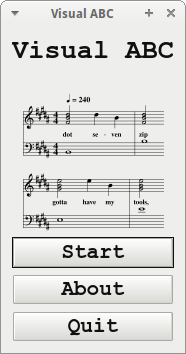
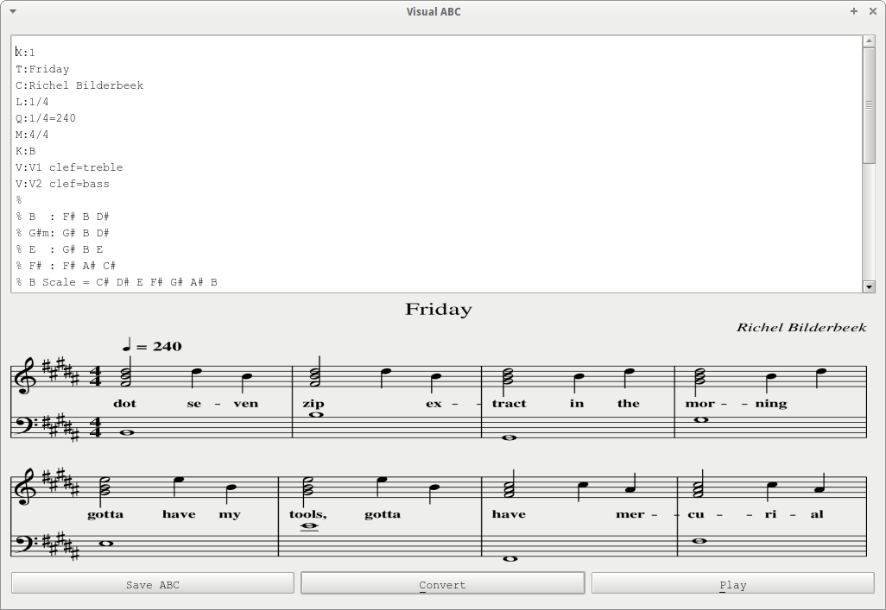

# VisualAbc

[Go to the nicely rendered
website](https://richelbilderbeek.github.io/VisualAbc/).

[![Build

Tool to write ABC music notation and immediatly see the sheet music, written in
C++ using Qt.

