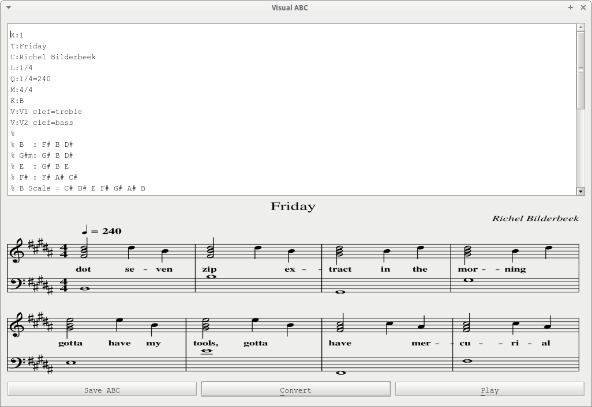

# VisualAbc

Visual ABC music notation editor.

VisualAbc is one of [Richèl Bilderbeek's tools](https://richelbilderbeek.github.io/tools/).

## Links

- [Source code](https://github.com/richelbilderbeek/VisualAbc)
- [Richèl Bilderbeek's tools](https://richelbilderbeek.github.io/tools/)
